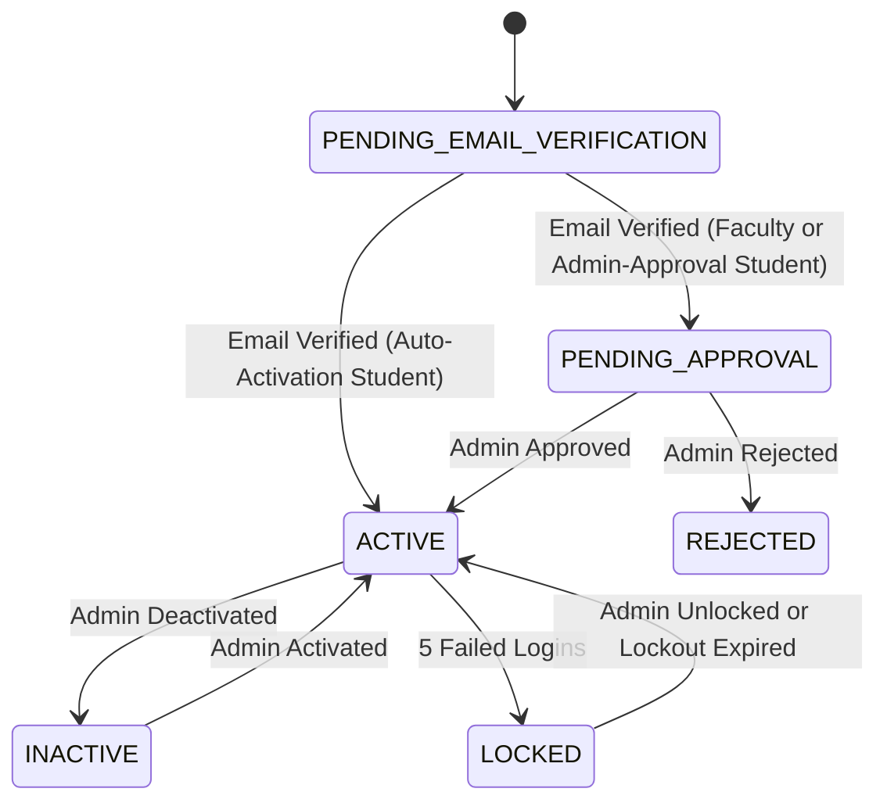

# Implementation Plan: Production-Structured Authentication, Registration, Account Approval & Role Management Workflow

This implementation plan details the architecture, database migrations, API contracts, frontend user flows, security controls, audit logs, quality gates, and documentation for replacing the demo-only login behavior with a production-structured multi-user workflow for **Administrator**, **Faculty**, and **Student**.

---

## 1. Core User & Account Status Model

### Account Status State Machine
- `PENDING_EMAIL_VERIFICATION`: Initial state after registration.
- `PENDING_APPROVAL`: Email verified, awaiting administrator approval (Faculty mode & Admin-approval Student mode).
- `ACTIVE`: Fully verified, approved, and operational account.
- `REJECTED`: Faculty application rejected by an administrator with a mandatory audit reason.
- `INACTIVE`: Administratively deactivated account.
- `LOCKED`: Account locked due to 5 consecutive failed login attempts until lockout expiry.
- `SUSPENDED`: Account suspended due to security or disciplinary policy.

---

## 2. Database Schema Extensions (`008_auth_registration_approval_schema.py`)

### Modified / Extended Tables:
- `users`: Add `account_status` (VARCHAR(50), default `'PENDING_EMAIL_VERIFICATION'`), `failed_login_count` (INT, default 0), `locked_until` (TIMESTAMP), `last_login_at` (TIMESTAMP).
- `student_profiles`: Add `institution_id` (FK institutions), `programme_id` (FK programmes), `academic_year_id` (FK academic_years), `semester_id` (FK semesters), `preferred_language` (VARCHAR(20), default `'en'`), `phone_number` (VARCHAR(20)), `date_of_birth` (DATE).
- `faculty_profiles`: Add `institution_id` (FK institutions), `phone_number` (VARCHAR(20)), `subjects_handled` (JSON), `approval_status` (VARCHAR(50), default `'PENDING_APPROVAL'`), `approved_by` (FK users), `approved_at` (TIMESTAMP), `rejected_by` (FK users), `rejected_at` (TIMESTAMP), `rejection_reason` (TEXT).

### New Table:
- `faculty_approval_events`: `id` (UUID), `faculty_user_id` (FK users), `action` (VARCHAR(50)), `previous_status` (VARCHAR(50)), `new_status` (VARCHAR(50)), `administrator_id` (FK users), `reason` (TEXT), `created_at` (TIMESTAMP).

---

## 3. Required API Endpoints

### Public Metadata Endpoints (`/api/v1/public/`):
- `GET /api/v1/public/institutions`
- `GET /api/v1/public/institutions/{institution_id}/departments`
- `GET /api/v1/public/departments/{department_id}/programmes`
- `GET /api/v1/public/programmes/{programme_id}/academic-years`
- `GET /api/v1/public/programmes/{programme_id}/semesters`

### Authentication Endpoints (`/api/v1/auth/`):
- `POST /api/v1/auth/register/student`
- `POST /api/v1/auth/register/faculty`
- `POST /api/v1/auth/login` (Returns role-based redirect hint and HttpOnly JWT cookie)
- `POST /api/v1/auth/logout`
- `POST /api/v1/auth/refresh`
- `GET /api/v1/auth/me`
- `POST /api/v1/auth/verify-email`
- `POST /api/v1/auth/resend-verification`
- `POST /api/v1/auth/forgot-password`
- `POST /api/v1/auth/reset-password`
- `GET /api/v1/auth/account-status`

### Administrator Faculty Approval & User Management (`/api/v1/admin/`):
- `GET /api/v1/admin/faculty-approvals`
- `GET /api/v1/admin/faculty-approvals/{user_id}`
- `POST /api/v1/admin/faculty-approvals/{user_id}/approve`
- `POST /api/v1/admin/faculty-approvals/{user_id}/reject`
- `POST /api/v1/admin/faculty-approvals/{user_id}/request-information`
- `GET /api/v1/admin/users`
- `GET /api/v1/admin/users/{user_id}`
- `PATCH /api/v1/admin/users/{user_id}/activate`
- `PATCH /api/v1/admin/users/{user_id}/deactivate`
- `POST /api/v1/admin/users/{user_id}/unlock`
- `POST /api/v1/admin/users/{user_id}/revoke-sessions`
- `GET /api/v1/admin/students`
- `GET /api/v1/admin/students/{user_id}`

---

## 4. Frontend Pages & Navigation Structure

### Auth Pages:
- `/register` — Selection page (Student Card vs Faculty Card)
- `/register/student` — Multi-section student registration with dependent dropdowns, password strength meter, and terms consent
- `/register/faculty` — Multi-section faculty registration form
- `/register/success` — Registration success page
- `/login` — Unified login page with role-agnostic authentication and automatic role-based redirect
- `/account-status` — Real-time account status checker with approval status, email verification toggle, and safe rejection reason
- `/resend-verification` — Resend verification email portal
- `/verify-email` — Verification completion page
- `/forgot-password` & `/reset-password` — Password recovery portal

### Admin Management Pages:
- `/admin/faculty-approvals` — Faculty approval queue with status filters (Pending, Approved, Rejected)
- `/admin/faculty-approvals/[userId]` — Detailed inspection, approval dialog, and rejection modal requiring reason
- `/admin/students` — Student directory with institution, department, programme, and semester filters
- `/admin/students/[userId]` — Student detail view and enrolment management

---

## 5. Security & Audit Logging Requirements

1. **Argon2id Hashing**: All passwords hashed using Argon2id with strict strength validation (min 10 chars, upper, lower, number, special char, no email/ID inclusion).
2. **HttpOnly SameSite Cookies**: JWT access and refresh tokens stored strictly in HttpOnly, SameSite, Secure cookies. No localStorage storage.
3. **Failed Login Lockout**: 5 failed login attempts trigger temporary account lockout (`LOCKED` status) with audit log recording.
4. **Audit Logging**: Audit events generated for registration, email verification, login success/failure, lockout, password reset, approval, rejection, activation, deactivation, and session revocation.
5. **Development Test Accounts**: Clearly labeled as `DEVELOPMENT-ONLY TEST ACCOUNTS` in code, docs, and UI.

---

## 6. Verification & Quality Gate Plan

1. **Alembic Migration Upgrade & Downgrade**:
   - `python -m alembic upgrade head`
   - `python -m alembic downgrade -1`
   - `python -m alembic upgrade head`
2. **Backend Automated Quality Gates**:
   - `python -m pytest`
   - `python -m ruff check .`
   - `python -m mypy app`
3. **Frontend Automated Quality Gates**:
   - `npm run lint`
   - `npm run type-check`
   - `npm run test`
   - `npm run build`
4. **Documentation Documents**:
   - `docs/authentication-workflow.md`
   - `docs/student-registration.md`
   - `docs/faculty-registration-and-approval.md`
   - `docs/account-status-transitions.md`
   - `docs/development-test-accounts.md`
   - `docs/authentication-completion-report.md`
